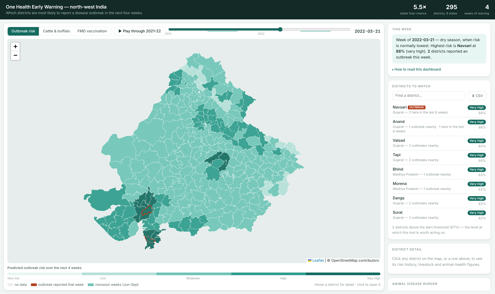

<div align="center">

# One Health Early Warning

**Which districts are most likely to report a disease outbreak in the next four weeks?**

India watches animal disease, human disease and climate in three systems that never talk to each other.
This builds the layer that does — one weekly table, one model, one map.

[](https://onehealth-early-warning.vercel.app)
&nbsp;
[](#results)
[](#data)
[](#data)
[](requirements.txt)
[](#licence)

<sub>Hack4Pashudhan · Track 5 (One Health Dashboard) · PGIVER Jaipur</sub><br>
<sub>Lakkarsu Nanditha · Ch. Vignesh Reddy</sub>



</div>

---

## The problem

India runs good disease surveillance. It runs it three times, in parallel, with no join:

| System | Watches | Blind to |
|---|---|---|
| **NADRES / NADRS** (ICAR-NIVEDI) | Livestock outbreaks · district · monthly | Whether people later fell ill |
| **IDSP / IHIP** (MoHFW) | Human outbreaks · district · weekly | What the local animals were doing |
| **IMD / satellite** | Rainfall, temperature, humidity | Linked to neither disease feed |

A district officer who wants to know *"is anything building here?"* has to open three portals and
hold the answer in their head. This project does the join once, weekly, and ranks the districts.

## Results

> Of the district-weeks flagged highest risk (top 5%), **8.4% saw a reported outbreak within four
> weeks, against a background rate of 1.6%** — a **5.4× lift, 95% CI 4.6–6.4**, on a test period the
> model never saw during training.

| | Measured | What it means |
|---|---|---|
| **Lift** | **5.4×** (CI 4.6–6.4) | An officer inspecting five districts a week finds ~5× more outbreaks than working down a random list |
| **Transfer** | **4.7×** mean on unseen states | Trained on eight states, tested on the ninth — it uses no district identity, so new districts need no retraining |
| **Recall at 5%** | 27.7% of all outbreaks | Random inspection at the same effort catches 5% |
| **Cost** | 10.6 false alarms per catch | At a 1.6% base rate, random inspection costs ~60 |
| **PR-AUC** | 0.068 ± 0.0015 (5 seeds) | Low in absolute terms; the lift is what is stable |

<details>
<summary><b>How much inspection effort is worth it?</b> — the 5% threshold, defended</summary>

<br>

5% was a choice, so we measured the alternatives. Lift decays steeply with effort; the threshold is
a budget decision, not a tuning parameter.

| Inspect | Outbreaks caught | Lift | False alarms per catch |
|---:|---:|---:|---:|
| 1% | 9.5% | 9.5× | 5.8 |
| 2% | 16.5% | 8.2× | 6.8 |
| **5%** | **27.7%** | **5.5×** | **10.6** |
| 10% | 37.2% | 3.7× | 16.3 |
| 15% | 45.7% | 3.0× | 20.2 |
| 20% | 51.8% | 2.6× | 23.8 |
| 30% | 65.8% | 2.2× | 28.3 |

5% is where lift is still strong and the waste still defensible. A district with spare capacity
should run at 10%: half again as many outbreaks caught, for 50% more waste per catch.

</details>

<details>
<summary><b>Where it is blind</b> — the most useful thing we know about our own model</summary>

<br>

The strongest feature is recent activity nearby, so we tested the obvious consequence: does it catch
outbreaks that *continue and spread*, and miss ones that *appear out of nowhere*? It does, starkly.

| Of 473 test outbreaks | Count | Caught in advance |
|---|---:|---:|
| Something active nearby or recently here | 218 | **57.8%** |
| Quiet beforehand — nothing nearby, nothing recent | 255 | **2.0%** |
| Monsoon weeks | 241 | 34.4% |
| Dry-season weeks | 232 | 20.7% |

A ~29× gap. **This is a tool for allocating follow-up where something is already stirring, not for
detecting emergence.** Over half of all outbreaks arrive with no warning signal in the open data, and
for those nothing replaces a report from the ground. Closing that gap needs a leading indicator the
open data does not carry — veterinary case reports, drug sales, animal movement records.

</details>

## What we found, including what failed

**Outbreak risk is strongly seasonal** — six times higher in July than January (19 vs 3 per 1,000
district-weeks). Monthly rainfall and outbreak rate correlate at 0.908: co-movement, since both are
seasonal, not causation.

**Four alternatives were built, measured and rejected on the evidence.** The production model is
what survived.

<details>
<summary><b>1. Weather anomalies</b> — a 1.96× effect that was pure seasonal leakage</summary>

<br>

Raw rainfall anomalies appeared to give a 1.96× risk ratio. That was leakage: rainfall deviates by
tens of millimetres in July and fractions in January, so every "extreme" week was a monsoon week.
After standardising anomalies per district-week — extreme weeks then spread across all 12 months —
the effect vanishes (**1.04×**). Dropped.

</details>

<details>
<summary><b>2. The animal layer</b> — present, mapped, and honestly non-predictive</summary>

<br>

Adding livestock population, FMD vaccination reach and FMD seroprevalence changes PR-AUC by
**+0.0013 on average, with the sign flipping across seeds** (sd 0.0048) while more than doubling
run-to-run variance. Excluded from the production model, retained in the pipeline and on the
dashboard. This is expected rather than disappointing: the human diseases in the open data
(diarrhoeal disease, dengue, malaria, cholera) are not livestock-transmitted.

</details>

<details>
<summary><b>3. Per-disease models</b> — sharper in principle, worse in practice</summary>

<br>

Dengue, diarrhoeal disease and cholera have different mechanisms, so separate models should be
sharper. They are not: diarrhoeal 4.1×, dengue 4.6×, cholera 5.3× against the combined **5.4×**,
because each model loses most of its training positives. Chikungunya and malaria have too few test
cases to measure at all. The combined target stays.

</details>

<details>
<summary><b>4. Two-hop spatial spread</b> — the border is where it stops</summary>

<br>

Adding a second ring of neighbours (neighbours-of-neighbours, median 12 districts) changes PR-AUC by
amounts that flip sign across seeds. One hop only.

</details>

<details>
<summary><b>And one thing that held:</b> district identity is not needed</summary>

<br>

Removing the district's own historical outbreak rate slightly *improves* the model (8.6% vs 8.4% hit
rate). So the forecast is not merely learning which districts report well — and it transfers to
districts never seen in training. **Four weeks is the right horizon, measured:** 1 week 6.2× (only
134 test cases), 2 weeks 5.0×, **4 weeks 5.5×**, 8 weeks 4.3×.

</details>

## Data

All sources are public, free and open. No fieldwork, no hardware, no licences, no API keys.

| Source | Gives | Resolution | Access |
|---|---|---|---|
| [EpiClim](https://zenodo.org/records/14580510) | Human outbreak records | District · weekly | Zenodo, CC BY 4.0 |
| [NASA POWER](https://power.larc.nasa.gov) | Temperature, rainfall, humidity | District · daily | Free API, no key |
| [20th Livestock Census 2019](https://publicdata.artpark.ai/en/latest/datasets/0041.html) | Cattle, buffalo, sheep, goat, pig | District | Open CSV |
| [FMD vaccination, NADCP](https://publicdata.artpark.ai/en/latest/datasets/0086.html) | Doses and farmers, rounds 1–6 | District | Open CSV |
| [FMD serosurveillance](https://publicdata.artpark.ai/en/latest/datasets/0089.html) | % bovines testing positive | State · yearly | Open CSV |
| [India district boundaries](https://github.com/datta07/INDIAN-SHAPEFILES) | Polygons and the adjacency graph | District | Open GeoJSON |

EpiClim **is** the IDSP data — the ministry's weekly outbreak reports, extracted from its PDFs and
published as one clean CSV. We first tried to scrape the IDSP portal directly; it was unreachable,
and EpiClim turned out to be the same source already parsed and quality-checked.

**Scope** · 295 districts across Rajasthan, Gujarat, Madhya Pradesh, Uttar Pradesh, Haryana, Punjab,
Delhi, Himachal Pradesh and Uttarakhand · 2015–2022, ISO weeks · **123,015 district-weeks**.

## Architecture

```
public sources ──▶ Python pipeline ──▶ static JSON ──▶ Leaflet dashboard
                   (weekly, GitHub Actions)
```

**There is no application server.** The data changes weekly; serving it live would add a deployment
that can fail and buys nothing. The pipeline writes static files and the map reads them, so the whole
thing hosts for free and cannot fall over mid-demo.

| Layer | Choice | Why |
|---|---|---|
| Processing | pandas, shapely | District polygons, adjacency, panel joins |
| Model | scikit-learn `HistGradientBoostingClassifier` | Strong on small tabular data, handles NaN natively, explains itself |
| Dashboard | Leaflet + OpenStreetMap | No API key, static hosting, canvas renderer for 295 live-restyled polygons |
| Refresh | GitHub Actions, weekly | Free, and the data updates no faster |

## Method

<details>
<summary><b>The decisions that make the numbers trustworthy</b></summary>

<br>

- **Time-based split, never random** — train 2015–2019, test 2021–2022. A random split lets the model
  see the future and reports a score that means nothing.
- **2020 excluded.** Reported outbreaks fell from 127 to 14 that year; COVID diverted surveillance,
  disease did not vanish.
- **PR-AUC and hit rate, not accuracy.** Outbreaks occur in 1.6% of district-weeks; a model
  predicting "never" scores 98% accuracy and is useless.
- **History windows end at week _t_** and the target covers _t+1_ to _t+4_, so no feature uses
  information unavailable at forecast time.
- **Five seeds and a 2,000-sample bootstrap**, with the operating threshold recomputed inside each
  resample. A gain that flips sign across seeds is noise, and we treat it as noise.
- **66 district-name aliases reconciled by hand.** Gurgaon→Gurugram, Allahabad→Prayagraj, Mewat→Nuh,
  Hoshangabad→Narmadapuram. Fuzzy matching proposed Rae-Bareilly→Bareilly — two different districts
  200 km apart — which is why every alias was checked rather than trusted.
- **Keys are (state, district).** Pratapgarh exists in both Rajasthan and Uttar Pradesh.
- **Every script runs an assert-based self-check** before writing anything. The model's self-check
  plants a synthetic neighbour-spread signal and fails if the model cannot recover it.

</details>

## Reproducing

```bash
pip install -r requirements.txt

curl -L -o data/raw/epiclim.csv \
  "https://zenodo.org/records/14580510/files/Final_data.csv?download=1"

cd src
python skeleton.py        # district × week grid                        (no network)
python fetch_climate.py   # NASA POWER → weekly climate       (~10 min, cached)
python fetch_animal.py    # FMD vaccination + seroprevalence
python build_map.py <INDIA_DISTRICTS.geojson>   # map + adjacency graph
python join.py            # → data/interim/panel.csv
python lag_analysis.py    # the weather-anomaly null result
python model.py           # trains, compares baselines, writes predictions.json
python evaluate.py        # seed stability + bootstrap CIs
python per_disease.py     # one model per disease   (rejected: worse than combined)
python ablations.py       # horizon sweep + two-hop spread    (two-hop rejected)
python validation.py      # transfer, confusion matrix, threshold sweep, blind spot
```

Then the dashboard:

```bash
python -m http.server 8000     # from the project root
# open http://localhost:8000/dashboard/
```

## Limitations

- **No zoonotic link is demonstrated.** The open human data covers diseases that are not
  livestock-transmitted. Brucellosis and anthrax are reported too rarely in open sources to model at
  district-week resolution.
- **It cannot see emergence.** Outbreaks with no recent local or neighbouring activity — 255 of 473,
  over half — are caught 2.0% of the time. That is a property of an activity-based feature set, not a
  bug to tune away.
- **Reported, not observed.** Surveillance records outbreaks that were *reported*; a better-staffed
  district reports more at the same true burden. Removing district identity limits, but does not
  eliminate, this.
- **Most flagged districts see nothing.** Precision at the operating threshold is 8.6%. This is a
  triage ranking for scarce inspection capacity, not a prediction that a named district will have an
  outbreak.
- **Human data ends in 2022.** EpiClim's coverage stops there; later IDSP records are not openly
  available in clean form.
- **A triage aid, not a diagnosis**, and not a replacement for surveillance.

## Repository

```
src/        pipeline, model, evaluation — each with a self-check
dashboard/  static Leaflet dashboard
docs/       screenshots
data/raw/       downloaded sources        (not committed — rebuilt by the pipeline)
data/interim/   built panel and outputs   (only the four files the dashboard reads)
```

## Licence

Code MIT. Data remains under its original licences: EpiClim CC BY 4.0, ARTPARK public data per its
repository, NASA POWER free for research.
