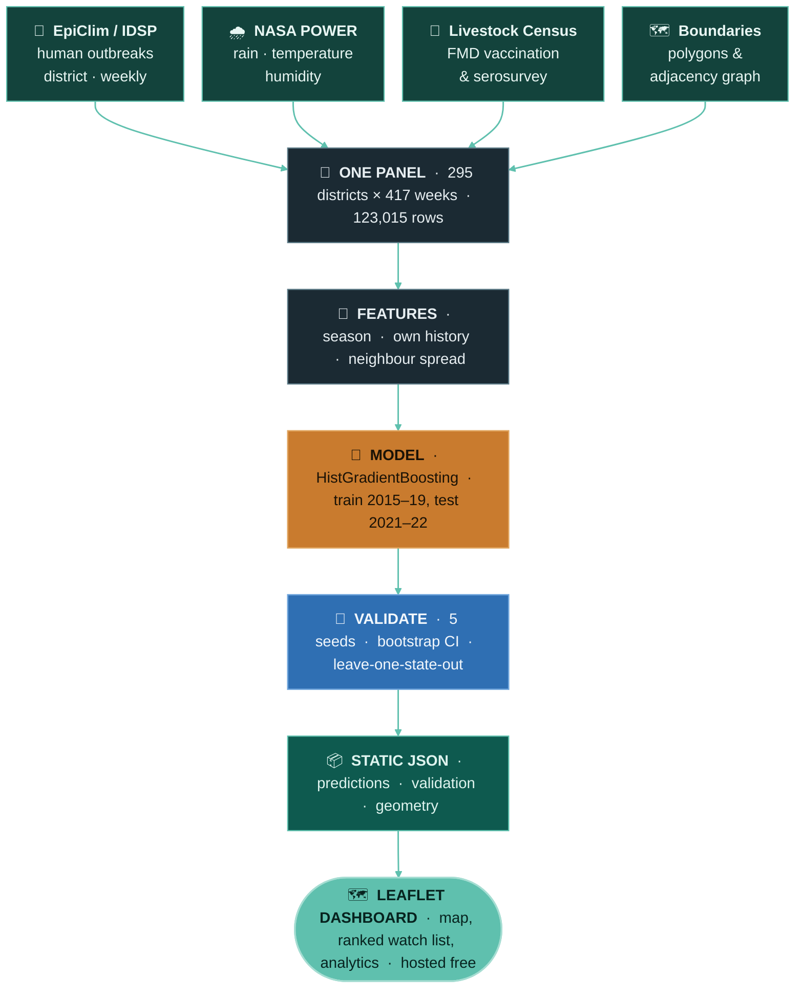

<div align="center">


# One Health Early Warning

### Forecasting District Disease Outbreak Risk from Animal, Human and Climate Surveillance

**A failed forecast is not a failed week. A missing one is.**

India watches animal disease, human disease and climate in three systems that never talk to each
other. This builds the layer that does — one weekly table, one model, one map — and ranks the
districts an officer should look at next.

<br>


<br>

**[Open the dashboard](https://onehealth-early-warning.vercel.app)**
&nbsp;·&nbsp; [Results](#results)
&nbsp;·&nbsp; [What failed](#what-we-found-including-what-failed)
&nbsp;·&nbsp; [Architecture](#architecture)
&nbsp;·&nbsp; [Data](#data)
&nbsp;·&nbsp; [Run it](#reproducing)

<br>


<sub>Two years of forecasts in fifteen seconds. Not an animation we drew — that is the model's weekly output, played back.</sub>

</div>

---

## Read this first

> **This forecasts *reported* outbreaks, and it is a ranking, not a prediction.**
>
> The model scores every district-week and sorts them. At the operating threshold, **8.6% of flagged
> district-weeks see an outbreak against a 1.6% background rate** — a far better order to work down
> than any alternative available, but not a claim that a named district *will* have an outbreak.
>
> Every figure below comes from **2021–22, a period held out of training entirely.** Nothing here is
> measured on data the model has seen.

---

## The problem

> A district veterinary officer can inspect maybe five places a week.
> There are 295 districts. Which five?

India runs good disease surveillance. It runs it three times, in parallel, with no join:

**NADRES** watches livestock outbreaks and never asks whether people later fell ill.
**IDSP** watches human outbreaks and never looks back at the local animals.
**IMD and satellites** measure the weather, and are linked to neither.

A district officer who wants to know *"is anything building here?"* has to open three portals and
hold the answer in their head. This project does the join once, weekly, and ranks the districts.

## Results

> Of the district-weeks flagged highest risk (top 5%), **8.4% saw a reported outbreak within four
> weeks, against a background rate of 1.6%** — a **5.4× lift, 95% CI 4.6–6.4**, on a test period the
> model never saw during training.

An officer who can inspect five districts a week finds roughly **five times more outbreaks**
working down this list than working down a random one.

It holds on states the model has never seen — **4.7× mean**, trained on eight states and tested on
the ninth, because it uses no district identity at all. It catches **27.7% of every outbreak** at 5%
inspection effort, where random inspection catches 5%. It costs about **10.6 false alarms per
catch**, where random inspection at this base rate costs around 60.

PR-AUC is 0.068 ± 0.0015 across five seeds — low in absolute terms, which is what a 1.6% base rate
does. The lift is the number that is stable, and it is the number an officer acts on.

<details>
<summary><b>How much inspection effort is worth it?</b> — the 5% threshold, defended</summary>

<br>

5% was a choice, so we measured the alternatives. Lift decays steeply with effort; the threshold is
a budget decision, not a tuning parameter.

| Inspect | Outbreaks caught | Lift | False alarms per catch |
|---:|---:|---:|---:|
| 1% | 9.5% | 9.5× | 5.8 |
| 2% | 16.5% | 8.2× | 6.8 |
| **5%** | **27.7%** | **5.5×** | **10.6** |
| 10% | 37.2% | 3.7× | 16.3 |
| 15% | 45.7% | 3.0× | 20.2 |
| 20% | 51.8% | 2.6× | 23.8 |
| 30% | 65.8% | 2.2× | 28.3 |

5% is where lift is still strong and the waste still defensible. A district with spare capacity
should run at 10%: half again as many outbreaks caught, for 50% more waste per catch.

</details>

<details>
<summary><b>Where it is blind</b> — the most useful thing we know about our own model</summary>

<br>

The strongest feature is recent activity nearby, so we tested the obvious consequence: does it catch
outbreaks that *continue and spread*, and miss ones that *appear out of nowhere*? It does, starkly.

| Of 473 test outbreaks | Count | Caught in advance |
|---|---:|---:|
| Something active nearby or recently here | 218 | **57.8%** |
| Quiet beforehand — nothing nearby, nothing recent | 255 | **2.0%** |
| Monsoon weeks | 241 | 34.4% |
| Dry-season weeks | 232 | 20.7% |

A ~29× gap. **This is a tool for allocating follow-up where something is already stirring, not for
detecting emergence.** Over half of all outbreaks arrive with no warning signal in the open data.

**So we attacked it, and the animal layer turned out to be the answer.** Five candidate features
that are non-zero when nothing has happened yet — cumulative 8-week rainfall, 4-week humidity,
state-level activity excluding this district and its neighbours, weeks since the last local
outbreak, and herd size — were each tested against the production model. One worked:

| | Cold-start recall | Overall lift | PR-AUC |
|---|---|---|---|
| Production | 2.6% ± 0.3% | 5.42× ± 0.11 | 0.0680 |
| **+ livestock density** | **9.8% ± 0.2%** | 5.36× ± 0.08 | 0.0674 |
| + all five candidates | 8.2% ± 1.5% | 4.74× ± 0.26 | 0.0617 |

**Herd size nearly quadruples cold-start detection at no material cost to overall lift**, stable
across five seeds. This is why it failed the earlier test and passes this one: while recent cases
are visible nearby, livestock density adds nothing and is drowned out by the activity features.
When every activity feature is zero, it is the only thing left to rank on.

It is a reallocation, not a free lunch: warm recall falls 57.8% → 46.7%, so at a fixed 5% budget
roughly 24 recurrence catches are traded for roughly 18 first appearances. We judge a novel
introduction worth more than another week of a known outbreak, but the production model keeps the
higher overall lift and we report both. `src/coldstart.py`.

</details>

## What we found, including what failed

**Outbreak risk is strongly seasonal** — six times higher in July than January (19 vs 3 per 1,000
district-weeks). Monthly rainfall and outbreak rate correlate at 0.908: co-movement, since both are
seasonal, not causation.

**Four alternatives were built, measured and rejected on the evidence.** The production model is
what survived.

<details>
<summary><b>1. Weather anomalies</b> — a 1.96× effect that was pure seasonal leakage</summary>

<br>

Raw rainfall anomalies appeared to give a 1.96× risk ratio. That was leakage: rainfall deviates by
tens of millimetres in July and fractions in January, so every "extreme" week was a monsoon week.
After standardising anomalies per district-week — extreme weeks then spread across all 12 months —
the effect vanishes (**1.04×**). Dropped.

</details>

<details>
<summary><b>2. The animal layer</b> — present, mapped, and honestly non-predictive</summary>

<br>

Adding livestock population, FMD vaccination reach and FMD seroprevalence changes PR-AUC by
**+0.0013 on average, with the sign flipping across seeds** (sd 0.0048) while more than doubling
run-to-run variance. Excluded from the production model, retained in the pipeline and on the
dashboard. This is expected rather than disappointing: the human diseases in the open data
(diarrhoeal disease, dengue, malaria, cholera) are not livestock-transmitted.

**But the rejection turned out to be conditional.** Tested against the model's blind spot rather
than its average, herd size nearly quadruples cold-start detection (2.6% → 9.8%, sd 0.2%). It adds
nothing while recent activity is visible and almost everything when there is none. A layer can be
useless on average and decisive in the cases that matter — see *Where it is blind* above.

</details>

<details>
<summary><b>3. Per-disease models</b> — sharper in principle, worse in practice</summary>

<br>

Dengue, diarrhoeal disease and cholera have different mechanisms, so separate models should be
sharper. They are not: diarrhoeal 4.1×, dengue 4.6×, cholera 5.3× against the combined **5.4×**,
because each model loses most of its training positives. Chikungunya and malaria have too few test
cases to measure at all. The combined target stays.

</details>

<details>
<summary><b>4. Two-hop spatial spread</b> — the border is where it stops</summary>

<br>

Adding a second ring of neighbours (neighbours-of-neighbours, median 12 districts) changes PR-AUC by
amounts that flip sign across seeds. One hop only.

</details>

<details>
<summary><b>And one thing that held:</b> district identity is not needed</summary>

<br>

Removing the district's own historical outbreak rate slightly *improves* the model (8.6% vs 8.4% hit
rate). So the forecast is not merely learning which districts report well — and it transfers to
districts never seen in training. **Four weeks is the right horizon, measured:** 1 week 6.2× (only
134 test cases), 2 weeks 5.0×, **4 weeks 5.5×**, 8 weeks 4.3×.

</details>

## Data

All sources are public, free and open. No fieldwork, no hardware, no licences, no API keys.

| Source | Gives | Resolution | Access |
|---|---|---|---|
| [EpiClim](https://zenodo.org/records/14580510) | Human outbreak records | District · weekly | Zenodo, CC BY 4.0 |
| [NASA POWER](https://power.larc.nasa.gov) | Temperature, rainfall, humidity | District · daily | Free API, no key |
| [20th Livestock Census 2019](https://publicdata.artpark.ai/en/latest/datasets/0041.html) | Cattle, buffalo, sheep, goat, pig | District | Open CSV |
| [FMD vaccination, NADCP](https://publicdata.artpark.ai/en/latest/datasets/0086.html) | Doses and farmers, rounds 1–6 | District | Open CSV |
| [FMD serosurveillance](https://publicdata.artpark.ai/en/latest/datasets/0089.html) | % bovines testing positive | State · yearly | Open CSV |
| [India district boundaries](https://github.com/datta07/INDIAN-SHAPEFILES) | Polygons and the adjacency graph | District | Open GeoJSON |

EpiClim **is** the IDSP data — the ministry's weekly outbreak reports, extracted from its PDFs and
published as one clean CSV. We first tried to scrape the IDSP portal directly; it was unreachable,
and EpiClim turned out to be the same source already parsed and quality-checked.

**Scope** · 295 districts across Rajasthan, Gujarat, Madhya Pradesh, Uttar Pradesh, Haryana, Punjab,
Delhi, Himachal Pradesh and Uttarakhand · 2015–2022, ISO weeks · **123,015 district-weeks**.

## Architecture



**There is no application server.** The data changes weekly; serving it live would add a deployment
that can fail and buys nothing. The pipeline writes static files and the map reads them, so the whole
thing hosts for free and cannot fall over mid-demo.

pandas and shapely do the joins and the geometry. The model is scikit-learn's
`HistGradientBoostingClassifier` — strong on small tabular data, handles missing values natively,
and explains itself. The map is Leaflet on OpenStreetMap, canvas-rendered so 295 polygons can be
restyled every frame during playback. A weekly GitHub Action re-runs the lot. No API keys anywhere.

## Method

<details>
<summary><b>The decisions that make the numbers trustworthy</b></summary>

<br>

- **Time-based split, never random** — train 2015–2019, test 2021–2022. A random split lets the model
  see the future and reports a score that means nothing.
- **2020 excluded.** Reported outbreaks fell from 127 to 14 that year; COVID diverted surveillance,
  disease did not vanish.
- **PR-AUC and hit rate, not accuracy.** Outbreaks occur in 1.6% of district-weeks; a model
  predicting "never" scores 98% accuracy and is useless.
- **History windows end at week _t_** and the target covers _t+1_ to _t+4_, so no feature uses
  information unavailable at forecast time.
- **Five seeds and a 2,000-sample bootstrap**, with the operating threshold recomputed inside each
  resample. A gain that flips sign across seeds is noise, and we treat it as noise.
- **66 district-name aliases reconciled by hand.** Gurgaon→Gurugram, Allahabad→Prayagraj, Mewat→Nuh,
  Hoshangabad→Narmadapuram. Fuzzy matching proposed Rae-Bareilly→Bareilly — two different districts
  200 km apart — which is why every alias was checked rather than trusted.
- **Keys are (state, district).** Pratapgarh exists in both Rajasthan and Uttar Pradesh.
- **Every script runs an assert-based self-check** before writing anything. The model's self-check
  plants a synthetic neighbour-spread signal and fails if the model cannot recover it.

</details>

## Reproducing

```bash
pip install -r requirements.txt

curl -L -o data/raw/epiclim.csv \
  "https://zenodo.org/records/14580510/files/Final_data.csv?download=1"

cd src
python skeleton.py        # district × week grid                        (no network)
python fetch_climate.py   # NASA POWER → weekly climate       (~10 min, cached)
python fetch_animal.py    # FMD vaccination + seroprevalence
python build_map.py <INDIA_DISTRICTS.geojson>   # map + adjacency graph
python join.py            # → data/interim/panel.csv
python lag_analysis.py    # the weather-anomaly null result
python model.py           # trains, compares baselines, writes predictions.json
python evaluate.py        # seed stability + bootstrap CIs
python per_disease.py     # one model per disease   (rejected: worse than combined)
python ablations.py       # horizon sweep + two-hop spread    (two-hop rejected)
python validation.py      # transfer, confusion matrix, threshold sweep, blind spot
python coldstart.py       # attacking the blind spot (livestock density: adopted finding)
```

Then the dashboard:

```bash
python -m http.server 8000     # from the project root
# open http://localhost:8000/dashboard/
```

## Scope, and what unlocks the next version

Every boundary below is a property of what is *openly published* in India today, not of the method.
Each one has a named key, and most of those keys already exist inside a government department.

**The zoonotic link is not yet demonstrated.** The open human feed covers diarrhoeal disease,
dengue, malaria and cholera — none livestock-transmitted. *Opens with:* district-level brucellosis
and anthrax from NADRS. The animal layer is built, mapped and joined, waiting on a disease that
actually crosses species.

**It reads continuation better than emergence.** Outbreaks with no recent activity nearby are
caught 2.6% of the time, against 57.8% when some signal is present — and herd size lifts that to
9.8%. *Opens with:* a leading indicator the open data does not carry — veterinary case reports,
animal-movement permits, pharmacy sales. Each is collected already; none is published.

**Reported, not observed.** Surveillance records what was *reported*, so a better-staffed district
reports more at the same true burden. *Opens with:* staffing or testing-volume denominators, which
would let reporting effort be modelled rather than suppressed.

**Human data ends in 2022.** EpiClim's published coverage stops there. *Opens with:* a standing
IHIP data-sharing agreement — the pipeline is already scheduled weekly.

Every one of these is a door that opens from the outside. The pipeline, the model and the
dashboard are already built and already scheduled — they refresh the week any one of these feeds
does.

## Repository

```
src/        pipeline, model, evaluation — each with a self-check
dashboard/  static Leaflet dashboard
docs/       screenshots
data/raw/       downloaded sources        (not committed — rebuilt by the pipeline)
data/interim/   built panel and outputs   (only the four files the dashboard reads)
```

## Licence

Code MIT. Data remains under its original licences: EpiClim CC BY 4.0, ARTPARK public data per its
repository, NASA POWER free for research.
